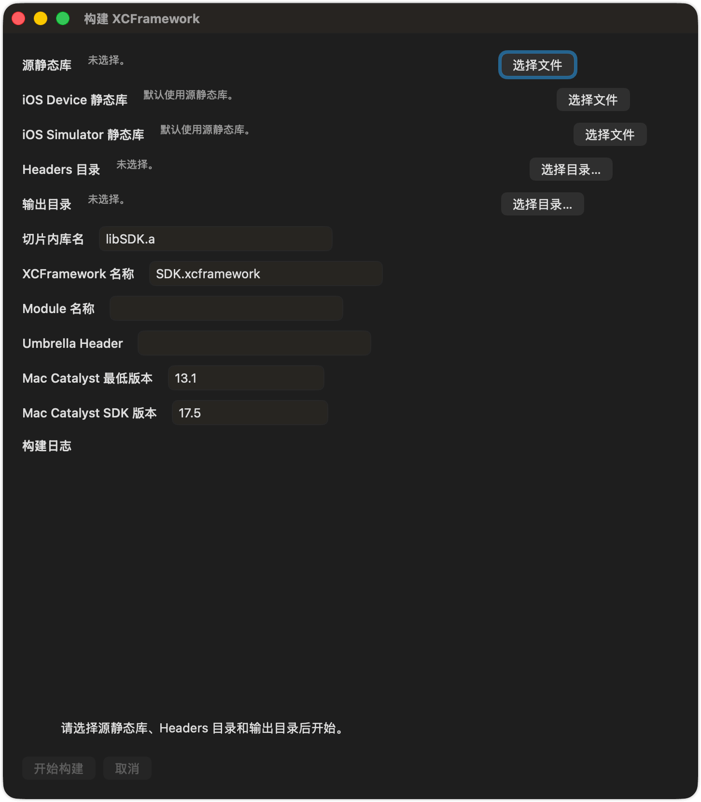
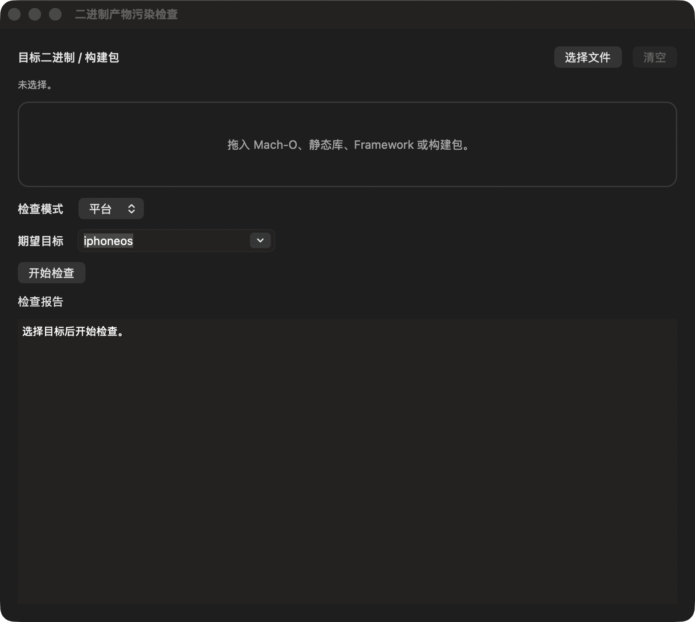
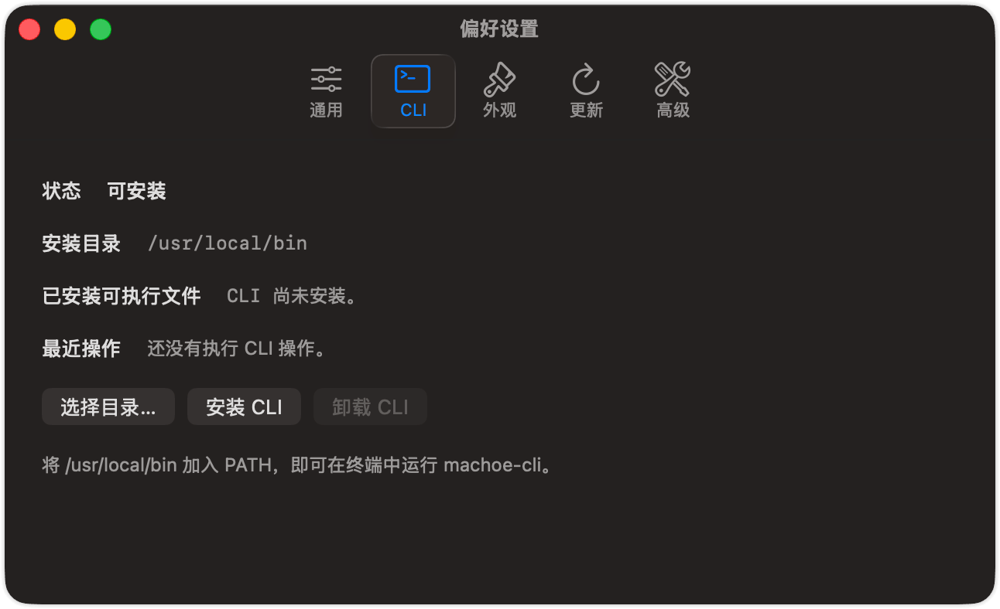

# MachOKnife

MachOKnife is a native macOS app for inspecting and editing Mach-O binaries — executables, dylibs, frameworks, object files, universal (fat) binaries, and static libraries (`.a`). It pairs a MachOView-style structure browser with a set of everyday binary tools (retag, XCFramework packaging, merge / split / remove architectures, contamination checks) and ships the same tooling as a command-line utility, `machoe-cli`.


<p align="center"><em>The main workspace: browse the structure tree on the left and inspect every field with its raw offset and bytes on the right.</em></p>

## Download

Grab the latest DMG from [GitHub Releases](https://github.com/wangwanjie/MachOKnife/releases/latest). Each release ships one DMG per architecture:

| Your Mac | Download |
| --- | --- |
| Apple Silicon (M1 and later) | `MachOKnife_V_<version>_arm64.dmg` |
| Intel | `MachOKnife_V_<version>_x86_64.dmg` |

Not sure? Open  > About This Mac: "Chip: Apple M…" means Apple Silicon, "Processor: Intel…" means Intel. Requires macOS 13.0 or later. Builds are signed with Developer ID and notarized, and the app keeps itself up to date through Sparkle — the update feed automatically serves the build that matches your Mac.

## Features

### Structure browser

- Mach header, load commands, segments and sections, dyld info / chained fixups, export trie, symbol / indirect symbol / string tables, code signature, Objective-C metadata, and relocations, laid out like MachOView
- thin and universal binaries, static libraries, and dyld shared caches
- `RAW` / `RVA` address modes, a field-level `Detail` table and a hex `Data` view
- structure search, ⌘C copy for the selected rows, and copy / export from the context menu
- large binaries stay responsive: symbols, strings, and other heavy groups are decoded on demand
- open files by drag and drop, `File > Open…`, Finder "Open With", or `File > Open Recent` (security-scoped bookmarks survive relaunches)

### Tools menu

Every tool opens pre-filled with the file currently open in the workspace.

- **Retag…** — rewrite platform, minimum OS, and SDK metadata (e.g. turn an iOS slice into a Mac Catalyst slice)
- **Build XCFramework…** — package iOS device / simulator static libraries and headers into an XCFramework, optionally generating Mac Catalyst slices automatically
- **Mach-O Summary…** — a one-page report for a binary or archive
- **Check Binary Contamination…** — find slices whose platform or architecture doesn't match what you expect
- **Merge / Split Mach-O…** — merge slices into a universal file, split a fat file per architecture, or strip unwanted architectures (for example simulator slices before an App Store upload)

| Retag | Build XCFramework |
| --- | --- |
|  |  |

| Check Binary Contamination | Preferences › CLI |
| --- | --- |
|  |  |

### Preferences

- **General** — language (English, 简体中文, 繁體中文; switches instantly)
- **CLI** — install or uninstall the bundled `machoe-cli` into a directory of your choice
- **Appearance** — follow system, light, or dark
- **Updates** — manual, daily, or at-launch update checks

## Command-line tool

Install `machoe-cli` from **Preferences › CLI**, then:

```bash
machoe-cli info /path/to/binary                # per-slice overview (add --json for machine-readable output)
machoe-cli summary /path/to/binary --json
machoe-cli list-dylibs /path/to/binary --json
machoe-cli check-contamination /path/to/libSDK.a --mode architecture --target arm64
machoe-cli merge arm64/libSDK.a x86_64/libSDK.a --output /tmp/libSDK.a
machoe-cli split /path/to/FatBinary --output-dir /tmp/slices --arch arm64
machoe-cli remove-arch MyLib.framework/MyLib --arch x86_64 --arch i386 --in-place
machoe-cli set-id libExample.dylib --install-name @rpath/libExample.dylib --output /tmp/libExample.dylib
machoe-cli rewrite-rpath libExample.dylib --from /old/path --to @loader_path/Frameworks --output /tmp/libExample.dylib
machoe-cli retag-platform libExample.dylib --platform macos --min 13.0 --sdk 14.0 --output /tmp/libExample.dylib
machoe-cli build-xcframework --source-library libSDK.a --ios-simulator-source-library libSDK-sim.a --headers-dir Headers --output /tmp/SDK.xcframework
machoe-cli fix-dyld-cache-dylib libCacheStyle.dylib --output /tmp/libCacheStyle.fixed.dylib
machoe-cli strip-signature /path/to/binary --output /tmp/binary
machoe-cli validate /path/to/binary
```

Run `machoe-cli help <command>` for every option. Conventions:

- reports go to stdout and errors to stderr; usage errors exit with `64`, and failed checks (`validate`, `check-contamination` mismatches) exit with `1`
- editing commands never overwrite their input implicitly: `--output` must differ from the input, and `remove-arch` needs an explicit `--in-place` to rewrite a file
- a single-value option given twice is rejected instead of silently picking one

## Building from source

```bash
pod install   # only needed if Pods/ is missing
xcodebuild build -workspace MachOKnife.xcworkspace -scheme MachOKnife -destination 'platform=macOS'
xcodebuild build -workspace MachOKnife.xcworkspace -scheme machoe-cli -destination 'platform=macOS'
```

Always build through `MachOKnife.xcworkspace`. Repository layout:

- `Packages/CoreMachO` — low-level parsing, archive inspection, and the edit planner / writer
- `Packages/RetagEngine` — platform and build-version retagging
- `Packages/MachOKnifeKit` — browser tree models, document analysis, and the tool services shared by the app and the CLI
- `Packages/MachOKnifeDB` — GRDB-backed recent files
- `MachOKnifeApp` / `MachOKnifeCLI` — thin AppKit and command-line front-ends
- `Resources/Localization` — `en`, `zh-Hans`, and `zh-Hant` strings
- `Scripts` — fixtures, DMG, appcast, and release helpers

## Tests

```bash
swift test --package-path Packages/CoreMachO
swift test --package-path Packages/RetagEngine
swift test --package-path Packages/MachOKnifeKit
swift test --package-path Packages/MachOKnifeDB
bash Scripts/build_fixtures.sh
xcodebuild test -workspace MachOKnife.xcworkspace -scheme MachOKnife -destination 'platform=macOS'
```

## Release workflow

```bash
bash Scripts/build_dmg.sh                       # builds, signs, and notarizes one DMG per architecture
bash Scripts/publish_github_release.sh --notes-file release-notes/vX.Y.Z.md
```

- `build_dmg.sh` builds `arm64` and `x86_64` separately (`--arch arm64|x86_64|all`), verifies each bundle only contains the target architecture, re-signs with Developer ID, and notarizes `build/dmg/MachOKnife_V_<version>_<arch>.dmg`
- `publish_github_release.sh` uploads every DMG of the current version to the GitHub release and then runs `generate_appcast.sh`
- `generate_appcast.sh` signs each DMG with Sparkle's EdDSA key and merges the items into `Resources/Updates/appcast.xml`; the arm64 item carries `<sparkle:hardwareRequirements>arm64</sparkle:hardwareRequirements>` and is listed first, so Intel Macs receive the x86_64 build and Apple Silicon Macs (including older universal installs) receive the arm64 build from the same feed
